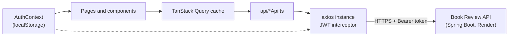

# Book Review Web Client

React + TypeScript single-page app for a community book-review site. Readers can browse, search and filter books, read reviews, write their own star-rated review and like other people's. The UI is in Vietnamese. It is the client for the [Book Review API](https://github.com/tinhne/book_review) (Spring Boot).


**Live demo:** [book-review-frontend-eta.vercel.app](https://book-review-frontend-eta.vercel.app) · **Backend:** [tinhne/book_review](https://github.com/tinhne/book_review)


## Overview

The client talks to a stateless JWT REST API. Server state (books, categories, reviews) is managed with TanStack Query. Search, filter, sort and page state live in the URL so results can be shared and survive back/forward navigation. Because the API runs on a free Render instance that sleeps when idle, the app first shows a skeleton app shell with a status banner and polls the API until it responds.

## Key features

- **Book discovery**
  - Search by title or author, debounced by 400 ms.
  - Category chips loaded from the API, in a single horizontally scrollable row with `aria-pressed` state.
  - Sort options: newest, highest rated, most reviewed, title (A–Z), each mapped to its own sort direction.
  - Server-side pagination at 12 books per page.
  - All of these are kept in the URL query string.
- **Book detail page** – cover (with a placeholder fallback), category, ISBN, rating summary and description, plus paginated reviews (10 per page) with an empty state. Network errors and missing books are handled separately, and "Back" falls back to the home page when the page was opened from a shared link.
- **Reviews**
  - Write or edit a review with a star rating and text. The rating control is a keyboard-accessible radio group (arrow keys, Home/End, visible focus). Forms use react-hook-form and zod, matching the API's rules: rating 1–5, 10–5000 characters, with a live character counter.
  - Authors can edit or delete their own reviews; deletion asks for confirmation in an accessible dialog (Radix Dialog).
  - Signed-in users can like or unlike reviews.
  - Caches are invalidated after each change so ratings and counts refresh.
- **Authentication**
  - Login and registration forms with client-side validation, including a password confirmation check.
  - The JWT is stored in `localStorage` and attached by an axios request interceptor.
  - A response interceptor clears the session and redirects to `/login` on `401`.
- **Loading, empty and error states** – skeleton cards that match the cover ratio, retryable error states, an "updating" indicator while a new page loads, and a contextual empty state with a "clear filters" action.
- **Resilience** – backend wake-up app shell (`BackendWakeUp`, up to 20 checks, 3 s apart), a React error boundary, lazy-loaded routes with a Suspense fallback, and toast notifications (sonner) that surface the API's error messages.
- **Responsive layout** – sticky navbar with a mobile menu (closes on Escape). The book grid uses `auto-fill` columns.

## Tech stack

Versions come from `pnpm-lock.yaml`.

| Layer | Technology |
| --- | --- |
| Framework | React 19.2.5, TypeScript 6.0.3 |
| Build tool | Vite 8.0.10 (`@vitejs/plugin-react` 6) |
| Routing | React Router 7.14.2 |
| Server state | TanStack Query 5.100.1, axios 1.15.2 |
| Forms | react-hook-form 7.73.1, zod 4.3.6, `@hookform/resolvers` |
| Styling | Tailwind CSS 3.4.19, shadcn-style components on Radix UI primitives, `class-variance-authority`, `tailwind-merge` |
| Icons and feedback | lucide-react, react-icons, sonner |
| Tooling | pnpm, ESLint 10 with typescript-eslint, react-hooks and react-refresh plugins |
| Hosting | Vercel (`vercel.json` rewrites every path to `index.html`) |

## Architecture



**Routes** (`src/App.tsx`, lazy-loaded):

| Path | Page |
| --- | --- |
| `/` | `HomePage`: search, category filter, sort, paginated grid |
| `/books/:id` | `BookDetailPage`: book info and reviews |
| `/login` | `LoginPage` |
| `/register` | `RegisterPage` |
| `*` | `NotFoundPage` |

**API endpoints used:**

| Area | Endpoints |
| --- | --- |
| Books and categories | `GET /api/books`, `GET /api/books/{id}`, `GET /api/categories` |
| Reviews | `GET /api/reviews/book/{bookId}`, `POST /api/reviews`, `PUT /api/reviews/{id}`, `DELETE /api/reviews/{id}`, `POST /api/reviews/{id}/like` |
| Auth | `POST /api/auth/login`, `POST /api/auth/register` |

See the [backend README](https://github.com/tinhne/book_review#api-reference) for the full contract.

## Project structure

```text
src/
├── api/               # axios instance + typed wrappers per resource
├── components/
│   ├── book/          # BookCard, BookGrid
│   ├── review/        # ReviewCard, ReviewForm
│   ├── layout/        # Navbar, Footer
│   ├── shared/        # BackendWakeUp, ConfirmDialog, ErrorBoundary, ErrorState, Pagination, StarRating, LoadingSpinner, ProtectedRoute
│   └── ui/            # shadcn-style primitives (button, card, input, badge, avatar, ...)
├── context/           # AuthContext (token + user in localStorage)
├── hooks/             # useAuth, useDebounce
├── pages/             # route components (+ SeederPage.jsx, a disabled dev tool)
├── types/             # API response types
└── utils/keepAlive.ts # early "wake up" ping to the API
```

## Getting started

### Prerequisites

- Node.js (a version supported by Vite 8) and [pnpm](https://pnpm.io/)
- A running [Book Review API](https://github.com/tinhne/book_review), locally on port 8080 or the deployed URL

### Install and run

```bash
pnpm install
cp .env.example .env      # set VITE_API_URL
pnpm dev                  # http://localhost:5173
```

The API's CORS configuration already allows `http://localhost:5173`.

### Other scripts

```bash
pnpm build     # type-check (tsc -b) and build to dist/
pnpm preview   # serve the production build
pnpm lint      # ESLint
```

## Environment variables

| Name | Required | Description |
| --- | --- | --- |
| `VITE_API_URL` | Yes | Base URL of the Book Review API, without a trailing slash (e.g. `http://localhost:8080`) |
| `VITE_LINK_GITHUB` | No | URL for the GitHub icon in the footer |
| `VITE_SEED_PAGE_PASSWORD` / `VITE_SEED_ADMIN_PASSWORD` / `VITE_SEED_USER_PASSWORD` | No | Only for the disabled seeding tool: unlock code, admin login, and the password given to generated demo accounts |

## Deployment

Deployed on Vercel at [book-review-frontend-eta.vercel.app](https://book-review-frontend-eta.vercel.app). `vercel.json` rewrites every path to `index.html` so client-side routes work on refresh. In production, `VITE_API_URL` points to the API on Render.

**Demo data.** The live catalogue was imported from [Open Library](https://openlibrary.org) with a seeding tool in `src/pages/SeederPage.jsx`, whose route is commented out in `App.tsx`. The tool also generated the demo reviewer accounts and reviews, so review activity on the demo site is sample data. Its credentials are read from local `VITE_SEED_*` variables and are never committed.

## Known limitations

- **No admin UI yet.** Admin users are recognised (badge in the navbar), but book and category management is only available through the API. `ProtectedRoute` exists for when an admin area is added.
- **Demo data quality.** A number of books imported from Open Library have their title and author fields swapped, and a few covers do not match the book. This is a data issue in the seeded catalogue, not in the UI.
- **Existing reviews are not detected up front.** If a signed-in user has already reviewed a book, the form is still shown and the API's "already reviewed" error appears on submit.
- **Expired tokens are not cleared automatically.** The API answers `403`, not `401`, so the interceptor's auto-logout does not trigger.
- **No automated tests.**

## Author

**Lê Văn Trung Tính** — Software Engineer | AI Product Builder

- Website: [trungtinh.site](https://trungtinh.site)
- GitHub: [@tinhne](https://github.com/tinhne)
